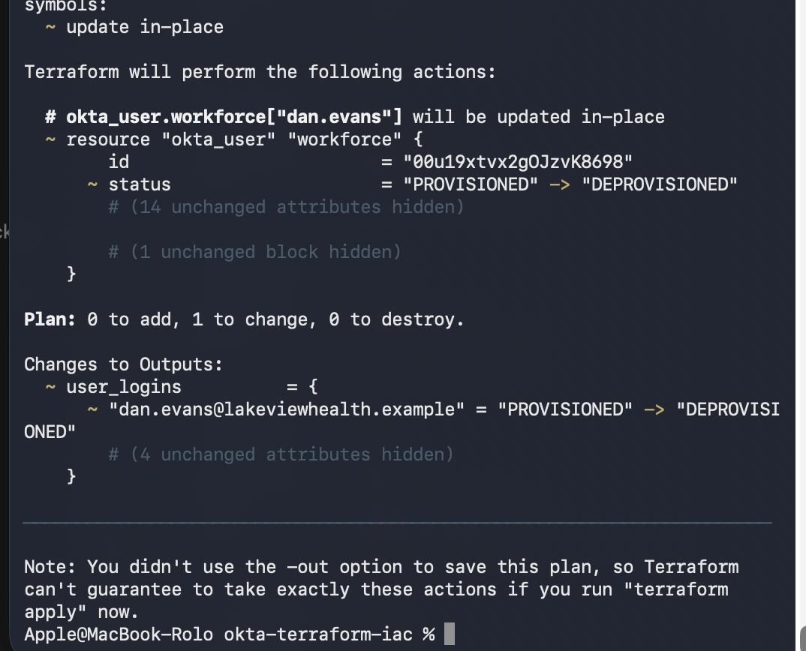
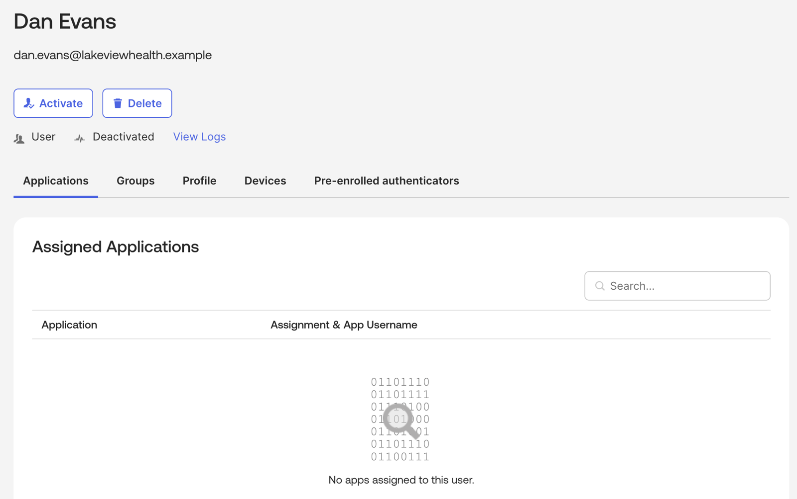
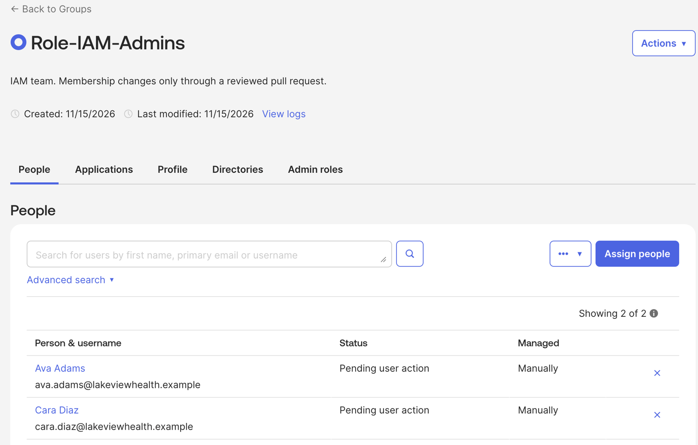
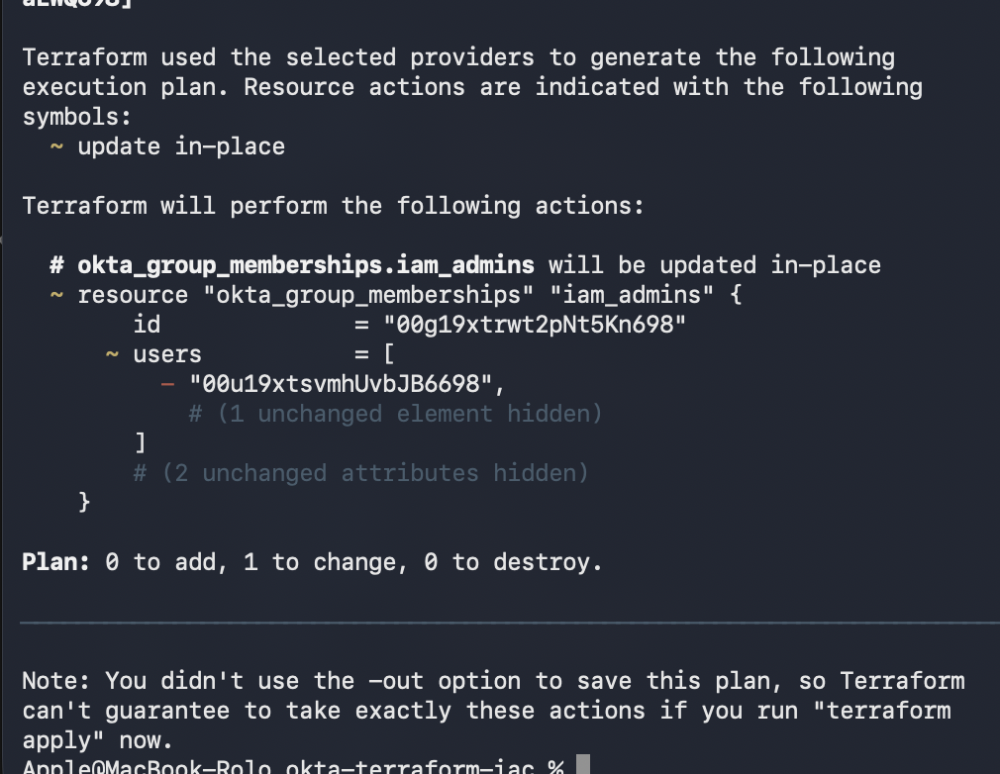
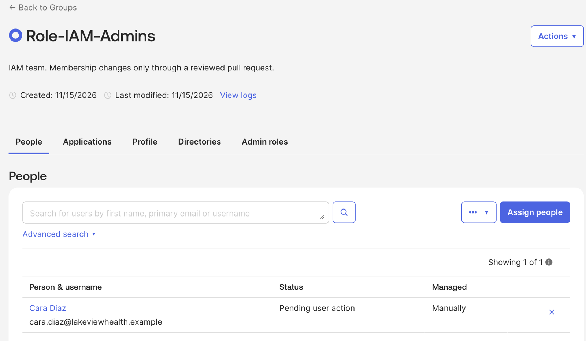
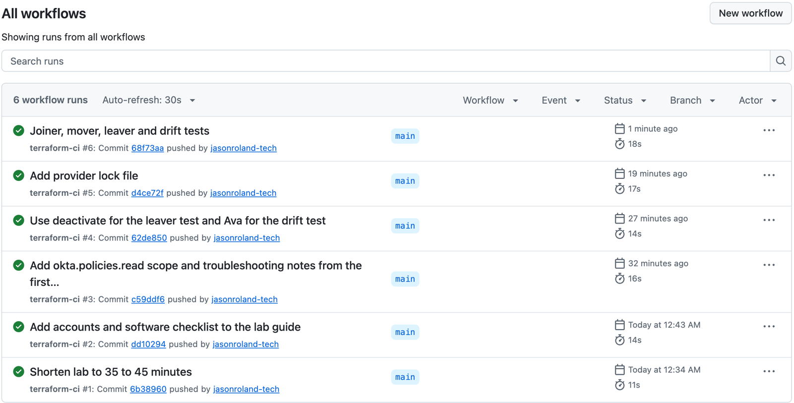

# Okta Managed with Terraform

> **Loom walkthrough:** _link coming soon_

I manage an Okta org entirely as code: users, groups, group rules, an app and its assignment all live in Terraform. Joiners, movers and leavers happen through a code change and `terraform apply`, and any change made by hand in the console shows up as drift.

## What this proves

| Skill | Evidence |
| --- | --- |
| Identity as code | Okta users, groups, rules and app access in Terraform ([`*.tf`](.)) |
| Non-human identity | Terraform signs in as an API Services app with a private key and scoped grants, no admin password |
| Attribute based access | Group rules place users by `department`; the app is assigned to groups only |
| Lifecycle | Joiner, mover and leaver done as reviewed code changes |
| Drift control | A manual console change caught by `terraform plan` and reverted |
| CI | GitHub Actions checks format and validates on every push |

## Design

```
variables.tf (users) ──> okta_user ──> group rules (department) ──> Dept-* groups ──> Lakeview GitHub app
                                  └──> Role-IAM-Admins (direct membership, PR only)
```

| Group | How members get in | Grants |
| --- | --- | --- |
| `Dept-Engineering` | Rule: `user.department=="Engineering"` | Lakeview GitHub |
| `Dept-Clinical` | Rule | (none yet) |
| `Dept-Finance` | Rule | (none yet) |
| `Role-IAM-Admins` | Direct membership in code | Admin team |

## Results

| Test | Expected | Result |
| --- | --- | --- |
| First apply | 4 users, 4 groups, 3 rules, 1 app | ✅ 14 resources created; Ava and Cara placed in Dept-Engineering by the rule |
| Joiner (Erin) | Lands in Dept-Engineering, gets GitHub | ✅ Added to the group by rule, GitHub tile assigned |
| Mover (Ben) | Clinical to Engineering, gains GitHub | ✅ `~ department` updated in place, same user ID; moved groups and gained GitHub |
| Leaver (Dan) | Deactivated, account kept for audit | ✅ `PROVISIONED -> DEPROVISIONED`, 1 change, 0 destroyed; no apps, logs kept |
| Drift | Ava added to admins by hand, caught and reverted | ✅ Plan flagged Ava's ID for removal; apply restored Cara as the only admin |

### Evidence

**Leaver:** the plan changes status only, nothing is destroyed. Okta shows Dan deactivated with no apps.




**Drift:** Ava added to Role-IAM-Admins in the console, caught by `terraform plan`, removed by `terraform apply`.





**CI:** every push is format checked and validated.



## Security notes

- No secrets in the repo: auth comes from environment variables, and the key file lives in `~/.okta` with `chmod 600`.
- State files are ignored in Git because they can hold user data.
- In production I'd use a custom admin role instead of Super Administrator for the Terraform app, and remote state with locking (HCP Terraform or S3).

## Run it

See [LAB-GUIDE.md](LAB-GUIDE.md).
